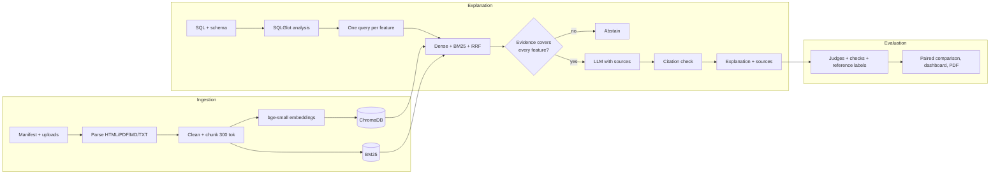

# SQL Explanation Grader: RAG Enhanced

Plain-language explanations of SQLite queries, written by a local LLM and graded by a second LLM, extended with **Retrieval-Augmented Generation**: before explaining a query, the system retrieves the relevant parts of official SQL documentation, cites them, and refuses to answer when it has no documentation for a feature the query uses. A controlled experiment compares the RAG system with the original prompt-only system.

The original grader (`harness/`, `dashboard/`, prompts `v1`/`v2`/`judge`, the 166-query dataset and all recorded results) is preserved and still runs with the same commands.

## Contents

1. [Overview](#1-overview) · 2. [Problem statement](#2-problem-statement) · 3. [Original vs RAG-enhanced](#3-original-vs-rag-enhanced) · 4. [Architecture](#4-architecture) · 5. [Technology stack](#5-technology-stack) · 6. [Installation](#6-installation) · 7. [Ollama setup](#7-ollama-setup) · 8. [Corpus ingestion](#8-corpus-ingestion) · 9. [RAG explanation workflow](#9-rag-explanation-workflow) · 10. [Evaluation methodology](#10-evaluation-methodology) · 11. [Running experiments](#11-running-experiments) · 12. [Results](#12-results) · 13. [Dashboard](#13-dashboard) · 14. [API](#14-api) · 15. [Testing](#15-testing) · 16. [Deployment](#16-deployment) · 17. [Known limitations](#17-known-limitations) · 18. [Future improvements](#18-future-improvements)

Further documents: [Architecture](docs/ARCHITECTURE.md) · [RAG pipeline](docs/RAG_PIPELINE.md) · [Evaluation](docs/EVALUATION.md) · [Presentation outline](docs/PROJECT_PRESENTATION.md) · [Teacher Q&A](docs/TEACHER_QA.md)

## 1. Overview

* **Input:** an SQLite `SELECT` query and the `CREATE TABLE` statements of its database.
* **Output:** one paragraph a non-technical reader can follow, with `[S1]`-style citations to documentation passages, a grounding status (grounded, weakly grounded, abstained, or fallback), and the retrieved passages with their scores.
* **Evaluation:** baseline and RAG explanations of the same queries are compared with a schema-aware rubric judge, a reproduction of the original judge, rule-based checks, citation checks and reference labels.

## 2. Problem statement

Small local LLMs explain SQL fluently but get details wrong: what a left join does with unmatched rows, how RANK treats ties, whether a range is inclusive, what `NULL` does in a comparison. They also invent business meaning that the schema does not support. The original project measured explanation quality with an LLM judge that did not even see the schema. This extension asks whether grounding the generator in trusted documentation makes explanations more correct, complete and reliable, and builds the evaluation needed to answer that honestly.

## 3. Original vs RAG-enhanced

| | Original | RAG-enhanced |
|---|---|---|
| Knowledge used | Model's internal knowledge only | Retrieved passages from 15 SQLite/PostgreSQL documentation pages |
| Prompt | `prompts/v2.md` | `prompts/v4_rag.md` = v2 verbatim + rules for using sources (v3 also kept) |
| Traceability | None | Citations checked against the passages actually provided |
| Unsupported features | Answers anyway | Abstains (or answers with an explicit "not grounded" label) |
| Judge input | SQL + explanation | Schema + SQL + parsed operation list + explanation |
| Judge output | good/bad + reason | 1–5 correctness, completeness, clarity, groundedness, unsupported claims, and good/bad |
| Evaluation | Judge approval | Judge approval, reference labels, deterministic checks, retrieval metrics, paired statistics |
| Interfaces | CLI, live dashboard | CLI, FastAPI + OpenAPI docs, new dashboard (legacy dashboard kept) |

## 4. Architecture



Details: [docs/ARCHITECTURE.md](docs/ARCHITECTURE.md) and [docs/RAG_PIPELINE.md](docs/RAG_PIPELINE.md).

## 5. Technology stack

| Purpose | Choice | Why |
|---|---|---|
| Language | Python 3.11 | Required by the stack; tested on 3.11.17 |
| LLMs | Ollama (`llama3.2:3b` generator, `qwen2.5:3b`/`qwen2.5:7b` judges) | Local, free, no API key; OpenAI-compatible endpoints also supported |
| Embeddings | `BAAI/bge-small-en-v1.5` via sentence-transformers | 33M parameters, 384 dimensions, fast on CPU, strong on retrieval benchmarks |
| Vector database | ChromaDB (persistent, cosine HNSW) | Embedded, no server to run, saves to disk |
| Keyword search | Okapi BM25 (own implementation, SQL-aware tokens) | Exact matching of keywords and function names |
| Fusion | Reciprocal Rank Fusion | No score calibration needed |
| SQL analysis | SQLGlot | Parses SQL into a syntax tree for features, LIMIT, sort direction |
| Parsing | BeautifulSoup, PyMuPDF, own Markdown/text parsers | HTML docs, PDFs, notes |
| Validation | Pydantic | Request models and structured LLM output |
| API | FastAPI + Uvicorn | Typed endpoints, interactive docs at `/docs` |
| Frontend | Plain HTML/CSS/JS (no build step) | Same approach as the original dashboard; light and dark themes |
| Reports | reportlab | Same library as the original PDF reports |
| Tests / lint | pytest, ruff, GitHub Actions | 130 offline tests |
| Deployment | Docker, docker compose | App + Ollama with persistent volumes |

## 6. Installation

```bash
git clone https://github.com/BLACK2202/sql-explanation-grader.git
cd sql-explanation-grader
python -m venv .venv
# Windows: .venv\Scripts\activate     macOS/Linux: source .venv/bin/activate
pip install --index-url https://download.pytorch.org/whl/cpu torch==2.7.1   # CPU build, small download
pip install -r requirements-dev.txt
cp .env.example .env    # optional; every setting has a default
```

`requirements.lock.txt` lists the exact versions used for the recorded experiments. On Windows, PyTorch 2.9 and later need a recent Visual C++ runtime (`VCRUNTIME140_THREADS.dll`); 2.7.1 works with older runtimes.

## 7. Ollama setup

Install Ollama from https://ollama.com, then:

```bash
ollama pull llama3.2:3b     # generator used in the experiments
ollama pull qwen2.5:3b      # judge (original project's judge)
ollama pull qwen2.5:7b      # optional stronger judge / the original default generator
```

Configure models with `SQLRAG_GENERATOR_MODEL` and `SQLRAG_JUDGE_MODEL` (defaults: `qwen2.5:7b` and `qwen2.5:3b`, as in `harness/run.py`; `.env.example` sets the smaller generator). On a 4 GB GPU, `SQLRAG_NUM_GPU=99` forces a 3B model fully onto the GPU; in our runs this cut generation time per item from about 65 s to 11–25 s.

## 8. Corpus ingestion

```bash
python scripts/fetch_corpus.py          # only needed to re-download; snapshots are committed
python -m sqlrag ingest                 # parse, chunk, embed, index (idempotent)
python -m sqlrag stats                  # collection, chunk and document statistics
python -m sqlrag ingest --doc sqlite-json                         # add the optional JSON page
python -m sqlrag ingest --files notes.pdf --title "My notes" --license "own work"
python -m sqlrag search "rows without a match in a left join" --mode hybrid
```

The corpus: 10 official SQLite pages (public domain) and 5 PostgreSQL 17 tutorial/reference pages (PostgreSQL License), listed with URL, license, date and hashes in `corpus/manifest.json` and `corpus/manifest.lock.json`; notices in `corpus/LICENSES.md`. Running `ingest` twice changes nothing the second time; changed documents replace their old chunks; duplicate documents and duplicate chunks are skipped.

## 9. RAG explanation workflow

```bash
python -m sqlrag retrieve "SELECT c.name FROM customers c LEFT JOIN orders o ON o.customer_id = c.id WHERE o.id IS NULL" --text
python -m sqlrag explain "SELECT city, COUNT(*) FROM customers GROUP BY city HAVING COUNT(*) > 2" \
    --schema "CREATE TABLE customers (id INTEGER PRIMARY KEY, name TEXT, city TEXT);" --mode-explain rag
```

1. Validate: one read-only query, compiled (never executed) in a private in-memory database with an authorizer.
2. Analyse with SQLGlot: features (LEFT JOIN, IS NULL, GROUP BY, window functions, ...), tables, LIMIT, sort direction.
3. Retrieve: one natural-language query per feature, dense + BM25 + Reciprocal Rank Fusion, relevance filter.
4. Check evidence: every feature that needs documentation must be covered by a selected passage; otherwise abstain (`SQLRAG_GROUNDING_POLICY=abstain`), answer with a `fallback_ungrounded` label (`fallback`), or answer anyway (`off`).
5. Generate with the sources wrapped as untrusted reference text and `[S#]` citations.
6. Validate citations and report the grounding status.

Step-by-step with all settings: [docs/RAG_PIPELINE.md](docs/RAG_PIPELINE.md).

## 10. Evaluation methodology

* **Controlled comparison:** same 50 dev queries, same generator (`llama3.2:3b`), same sampling (temperature 0, seed 42, 8,192-token context), same judges, alternating order. The RAG prompt is the baseline prompt plus a section on using sources.
* **Measurements:** reference labels (AI-assisted, clearly separated from the human labels the dashboard can collect), LLM-judge approval and rubric scores, rule-based checks, citation validity and support, abstention precision/recall, retrieval Recall@k / Precision@k / MRR / nDCG, latency and tokens.
* **Statistics:** Wilson intervals, exact McNemar test on paired outcomes, paired bootstrap intervals.
* **Judge reliability:** accuracy, precision, recall, F1, Cohen's κ and confusion matrices of each judge against the reference labels.
* **Metadata:** dataset and prompt hashes, model digests, retrieval configuration, seed, environment and git commit in every `results/rag/<experiment>/metadata.json`.

Details and threats to validity: [docs/EVALUATION.md](docs/EVALUATION.md).

## 11. Running experiments

```bash
# Original pipeline (unchanged commands; the judge now also receives the schema)
python harness/validate.py
python harness/run.py dev prompts/v2.md v2 --system-model qwen2.5:7b --judge-model qwen2.5:3b
python harness/run.py dev prompts/v2.md v2_old --legacy-judge-input     # reproduce the old judge input
python harness/analyze.py results/v2_dev.jsonl
python harness/export_pdf.py results/v2_dev.jsonl

# RAG extension
python -m sqlrag retrieval-eval --split all --chunk-sizes 400,200,300,500,600
python -m sqlrag experiment dev my_exp --generator-model llama3.2:3b --judge-model qwen2.5:3b
python -m sqlrag experiment dev my_exp --phase judge --judge-model qwen2.5:7b      # add another judge
python -m sqlrag experiment dev my_exp --phase judge --judge-mode legacy           # original judge prompt
python -m sqlrag experiment abstention_probe probe
python -m sqlrag summarize results/rag/my_exp        # summaries, CSV, PDF in reports/
python -m sqlrag agreement                           # judge vs reference labels
```

Experiments are resumable: rerunning a command skips finished items. Each judge writes its own `judgments__<model>__<mode>.jsonl`, and a legacy-format copy (`results/<exp>-<condition>-<judge>_<split>.jsonl`) that the original dashboard, `analyze.py` and `export_pdf.py` can read.

## 12. Results

All numbers are from runs in this repository (generator `llama3.2:3b`, temperature 0, seed 42, on a 4 GB RTX 2050). Full tables, methods and threats to validity: [docs/EVALUATION.md](docs/EVALUATION.md).

| | Baseline (prompt only) | RAG |
|---|---|---|
| Dev, reference labels "good" (AI-assisted, 50 pairs) | 20/50 | v3: 10/50 (−20 pts, p = 0.053) · v4 focused: 16/50 (−8 pts, p = 0.54) |
| Test, held out, reference labels "good" (random 40, blind) | 16/40 | v4: 11/40 (−12.5 pts, 95% CI −30 to +5, p = 0.27) |
| Citations to passages that were not provided | n/a | 0 |
| Abstention probe: undocumented / documented features | answers all 20 | 10/10 abstained · 10/10 answered |
| Mean time and input tokens per explanation (test) | 5.6 s · 573 | 10.2 s · 1,434 |

**Answer to the research question.** With a 3B generator, retrieval augmentation did **not** improve explanation correctness: the first design was worse, the focused design was not significantly different, and the held-out test agrees. Retrieved documentation tempted the small model to copy general statements that are false for the specific query (for example "the joins produce the same result as a CROSS JOIN"). RAG did make the system more *reliable* in the narrow sense it can guarantee: every citation is verifiable, and queries using undocumented features are refused instead of answered.

**About the judges.** The schema-aware 3B rubric judge approved 99/100 dev explanations (Cohen's κ 0.01 against the reference labels). The 7B judge agreed better (κ 0.26) but still approved 71% where the labels found 30% good. Judge approval alone would have hidden the v3 regression; that is why the reference labels lead the comparison. They are AI-assisted labels, not human ground truth; the dashboard's labelling page collects human labels separately.

**Retrieval.** One retrieval query per SQL feature (via SQLGlot) beat the raw SQL as a query (context recall 0.89 vs 0.80); 300-token chunks fit the embedder's 512-token window (at 500–600 tokens about 40% of chunks were truncated); BM25 alone was slightly better than hybrid on context recall here.


## 13. Dashboard

```bash
python -m sqlrag serve          # http://127.0.0.1:8000  (API docs at /docs)
python dashboard/server.py      # original live dashboard, http://localhost:7860 (also at /legacy)
```

* **SQL Playground:** query and schema editors, example picker (dev set and abstention probes), Baseline / RAG / Compare both, grounding policy, optional judge. Shows the explanation with clickable citations, grounding status, detected SQL features with coverage ticks, the retrieval queries, and every retrieved passage with dense, BM25 and fused scores.
* **Evaluation:** experiment and judge selectors; headline tiles with reference-label and LLM-judge results, each labelled with its provenance; rubric and per-feature charts with table views; deterministic checks; latency and tokens; grounding; retrieval ablation; judge agreement with confusion matrices; historical runs; an item inspector with filters (disagreements, abstentions) showing both explanations side by side.
* **Knowledge Base:** indexed documents with license, chunks and status; ingest optional manifest documents; upload PDF/Markdown/HTML/text; view chunks; test searches in each mode.
* **Reports:** generate the comparative PDF, download CSV/JSON, open all PDF reports (historical ones included).
* **Human labelling:** blind good/bad labelling that writes `label_source: "human"` labels.

## 14. API

| Method | Path | Purpose |
|---|---|---|
| GET | `/api/health` | Index status and Ollama models |
| POST | `/api/explain` | Explain (`mode`: baseline, rag, both; optional `judge`) |
| POST | `/api/evaluate` | Grade a given explanation (rubric or legacy judge) + checks |
| POST | `/api/retrieve` | Evidence for an SQL query, or free-text search |
| POST | `/api/ingest` | Upload and index a document (multipart) |
| POST | `/api/ingest/manifest` | Index manifest documents |
| GET / DELETE | `/api/documents`, `/api/documents/{id}` | List, inspect chunks, remove |
| GET | `/api/experiments`, `/api/experiments/{id}/items`, `.../export`, `.../report.pdf` | Results, exports, PDF |
| GET | `/api/agreement`, `/api/retrieval-eval`, `/api/historical`, `/api/reports` | Evaluation data |
| GET / POST | `/api/labels/next`, `/api/labels` | Blind human labelling |

```bash
curl -X POST http://127.0.0.1:8000/api/explain -H "Content-Type: application/json" -d '{
  "sql": "SELECT name, RANK() OVER (ORDER BY price DESC) FROM products",
  "schema": "CREATE TABLE products (id INTEGER PRIMARY KEY, name TEXT, price REAL);",
  "mode": "both", "judge": true }'

curl -X POST http://127.0.0.1:8000/api/retrieve -H "Content-Type: application/json" \
  -d '{"query": "how does RANK handle ties", "mode": "hybrid", "top_k": 3}'

curl -X POST http://127.0.0.1:8000/api/ingest -F file=@notes.md -F title="Join notes" -F license="own work"
```

Errors: invalid SQL → 422 `invalid_sql`; LLM down → 502 `llm_unavailable`; timeout → 504. Set `SQLRAG_ADMIN_TOKEN` to require an `X-Admin-Token` header on ingest, delete and labelling, or `SQLRAG_ALLOW_INGEST=0` to disable ingestion.

## 15. Testing

```bash
pytest -q                          # 130 offline tests: no models downloaded, no Ollama needed
RUN_OLLAMA_TESTS=1 pytest -m ollama   # 3 integration tests against a local Ollama
ruff check sqlrag tests scripts
```

The offline suite uses a hashing embedder, temporary ChromaDB stores and a scripted fake LLM. It covers parsing, chunking, indexing, idempotency, duplicates, retrieval and fusion, SQL analysis and safety, citations, prompt formats and injection hygiene, grounding policies, judges, checks, statistics, experiment checkpoint/resume, agreement, the API, and regression checks that the original pipeline, prompts and recorded results are unchanged. GitHub Actions (`.github/workflows/ci.yml`) runs lint, dataset validation, the tests, and a Docker build.

## 16. Deployment

```bash
cp .env.example .env
docker compose up -d --build       # Ollama + model pull + app; open http://localhost:8000
docker compose logs -f app
```

Volumes keep the Ollama models, the vector index, uploads, labels, results and reports. The `ollama` service requests an NVIDIA GPU; remove the `deploy` block on CPU-only hosts. The app container indexes the corpus on start (a no-op when unchanged) and has a health check on `/api/health`.

**Status:** no hosted deployment was made. The full system needs an LLM server, and no hosting credentials were available. The Docker setup was written for this purpose; see [docs/EVALUATION.md](docs/EVALUATION.md) and the pull request for what was verified locally. To host it, run the compose file on any VM with Docker (a GPU is optional for 3B models), or point `SQLRAG_LLM_PROVIDER=openai` with `SQLRAG_OPENAI_BASE_URL`/`SQLRAG_OPENAI_API_KEY` at a hosted OpenAI-compatible model and run only the `app` service.

## 17. Known limitations

* No human labels yet; the main quality comparison uses AI-assisted reference labels, which are a second opinion, not ground truth.
* The 3B rubric judge approves almost everything; LLM-judge approval alone is not a reliable quality measure here.
* 50 dev pairs are few; most differences are within the uncertainty.
* With a 3B generator, RAG did not improve explanation correctness (section 12); results may differ with larger models.
* Evidence coverage is checked lexically (does a passage contain the feature's keywords), which can accept a passage that only mentions a keyword in passing.
* The corpus is small (15 pages) and SQLite-centred; PostgreSQL pages differ slightly in dialect.
* The rule-based checks use word lists and miss paraphrases; they check mentions, not truth.
* The dataset's queries were generated by an LLM and include some unnatural joins.
* The repository has no LICENSE file; reuse terms of the code are up to the original authors.

## 18. Future improvements

* Collect human labels with the labelling page and re-measure both the judge and the AI-assisted labels.
* Repeat the comparison with a larger generator (`qwen2.5:7b` on a bigger GPU, or a hosted model).
* Retrieve-then-verify: let the model write from the SQL first, then use passages only to check and correct specific claims.
* Semantic coverage checks (passage–feature entailment) instead of keyword matching.
* Curate short, plain-language feature notes alongside the reference documentation.
* Add a cross-encoder re-ranker and evaluate it with human relevance judgements.
