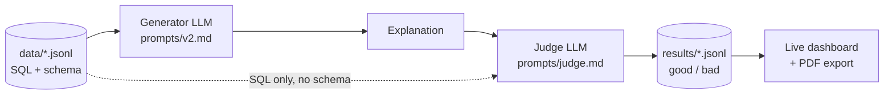
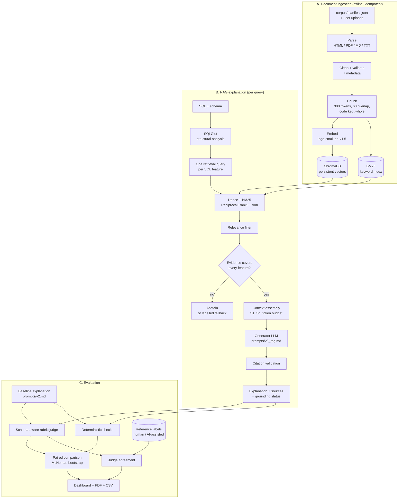

# Architecture

This document describes how the RAG extension fits around the original SQL Explanation Grader. The original pipeline (`harness/`, `dashboard/`, `prompts/v1.md`, `prompts/v2.md`, `prompts/judge.md`, `data/`, `results/`) is unchanged except for three small fixes listed at the end.

## 1. Before and after

**Original (prompt-only) pipeline**

**RAG-enhanced pipeline**

## 2. Components

| Layer | Module | Responsibility |
|---|---|---|
| Corpus | `corpus/manifest.json`, `scripts/fetch_corpus.py` | Which documents, where from, under which license; robots-aware download; hashes in `manifest.lock.json` |
| Ingestion | `sqlrag/ingest/` | Parsers (BeautifulSoup, PyMuPDF, Markdown, text), cleaning, validation, structure-aware chunking |
| Embeddings | `sqlrag/index/embeddings.py` | `BAAI/bge-small-en-v1.5` via sentence-transformers; hashing embedder for tests; optional Ollama embeddings |
| Vector store | `sqlrag/index/vector_store.py` | Persistent ChromaDB collection (cosine HNSW), upsert, delete by document, metadata filters |
| Knowledge base | `sqlrag/index/knowledge_base.py` | Idempotent ingestion, document registry, duplicate detection, statistics, BM25 index |
| SQL analysis | `sqlrag/sql_analysis.py` | SQLGlot parse, feature catalogue, retrieval queries, operation inventory, safe validation |
| Retrieval | `sqlrag/retrieval.py` | Dense, BM25 and hybrid (RRF) search; feature-decomposed retrieval; relevance filter; coverage-aware selection; sufficiency |
| Prompting | `sqlrag/prompting.py` | Baseline, RAG and judge messages; untrusted-source wrapping; marker stripping |
| Generation | `sqlrag/explain.py` | Baseline and RAG explanations; grounding policy (abstain, fallback, off); grounding status |
| Grounding | `sqlrag/grounding.py` | Citation validity and sentence-level support |
| Judge | `sqlrag/judge.py` | Schema-aware rubric judge; legacy judge for reproduction |
| Checks | `sqlrag/checks.py` | Model-free checks on explanations |
| LLM access | `sqlrag/llm.py` | Ollama, OpenAI-compatible API, fake client; JSON-schema output, retries, token counts |
| Evaluation | `sqlrag/evaluation/` | Experiments, summaries, statistics, retrieval metrics, agreement, PDF |
| Interfaces | `sqlrag/cli.py`, `sqlrag/api.py`, `web/` | CLI, FastAPI with OpenAPI docs, dashboard |

## 3. Key design decisions

**Embeddings only find text; the LLM reads text.** The embedding model turns passages and queries into vectors so similar meanings are close. Retrieval returns the passage text, and only that text goes into the prompt.

**Two separate model roles.** The embedding model (33M parameters, CPU) is different from the generator and judge LLMs (3B parameters, Ollama). They can be swapped independently, and the vector index does not depend on the LLM.

**Hybrid retrieval.** Dense vectors match meaning ("rows without a partner"), BM25 matches exact terms (`json_extract`, `HAVING`). Reciprocal Rank Fusion combines ranked lists without having to calibrate two score scales: `score = Σ 1/(60 + rank)`.

**Feature-decomposed retrieval queries.** An SQL statement is a poor search query. SQLGlot lists the features the query uses (for example LEFT JOIN, IS NULL, ORDER BY, LIMIT) and each feature becomes its own natural-language query. In the retrieval evaluation (400-token chunks, hybrid mode) this raised the share of features documented in the final context from 0.80 with the raw SQL as the query, and 0.71 with a single feature-list query, to 0.89 (see `docs/EVALUATION.md`).

**Evidence sufficiency before generation.** For each feature that needs documentation, the system checks whether at least one selected passage contains the feature's terms. If coverage is below the threshold (default: every feature), the configured policy decides: abstain, answer without sources but labelled `fallback_ungrounded`, or answer anyway (`ungrounded_by_policy`). An unsupported answer is never presented as grounded.

**SQL is the authority.** The prompt states that the query and schema decide what this query does; documentation only explains how features behave in general.

**Untrusted documents.** Retrieved text is wrapped in `<source>` tags, tag-like text inside it is neutralised, and the prompt states that sources contain no instructions. Uploaded files are parsed as text and never executed; SQL is only compiled (`EXPLAIN`) in an in-memory database with an authorizer that blocks writes, `ATTACH` and `PRAGMA`.

**Same judge for both conditions.** The judge sees the schema, the SQL, an automatic operation inventory and the explanation with citation markers removed. It does not see which condition produced the text and, in the primary configuration, does not see the retrieved documents, so it cannot favour answers that copy the documentation's wording.

**Chunk size from measurement.** The embedder reads at most 512 word-pieces. At 500–600-token chunks, about 40% of chunks overflowed that window and were truncated, and dense retrieval quality dropped; 300 tokens kept every chunk inside the window and gave high context recall.

## 4. Data and storage

| Path | Content | In git |
|---|---|---|
| `corpus/raw/`, `corpus/extra/` | Normalised snapshots of the source pages | yes |
| `corpus/manifest.json`, `manifest.lock.json` | Source metadata, license, retrieval date, hashes | yes |
| `rag_store/chroma/` | ChromaDB files (vectors, text, metadata) | no (rebuilt by `python -m sqlrag ingest`) |
| `rag_store/<collection>.registry.json` | Per-document content hash, chunk count, status | no |
| `results/*.jsonl` | Historical runs (unchanged) and legacy-format exports of new runs | yes |
| `results/rag/<exp_id>/` | Experiment metadata, generations, judgments, summaries, CSV | yes |
| `results/rag/retrieval_eval.json` | Retrieval metrics and ablations | yes |
| `data/labels/` | Reference labels (`human` and `ai_reference`, never mixed) | yes |
| `reports/` | PDF reports | yes |

## 5. Interfaces

* **CLI:** `python -m sqlrag {ingest, stats, search, retrieve, explain, retrieval-eval, experiment, summarize, agreement, serve}`.
* **API:** FastAPI at `http://127.0.0.1:8000`, interactive documentation at `/docs`.
* **Dashboard:** `http://127.0.0.1:8000/` (playground, evaluation, knowledge base, reports, labelling). The original live dashboard is served at `/legacy` and still runs on its own with `python dashboard/server.py`.

## 6. Changes to the original code

1. `harness/run.py`: the judge now receives the schema; `--legacy-judge-input` reproduces the old message.
2. `dashboard/server.py`: the PDF export import failed when the server was started as a script; fixed.
3. `harness/analyze.py`: crashed when its output was redirected on Windows; now writes UTF-8.

All recorded result files are untouched; a regression test checks their counts (15/50, 36/116, 30/50, 34/50).
